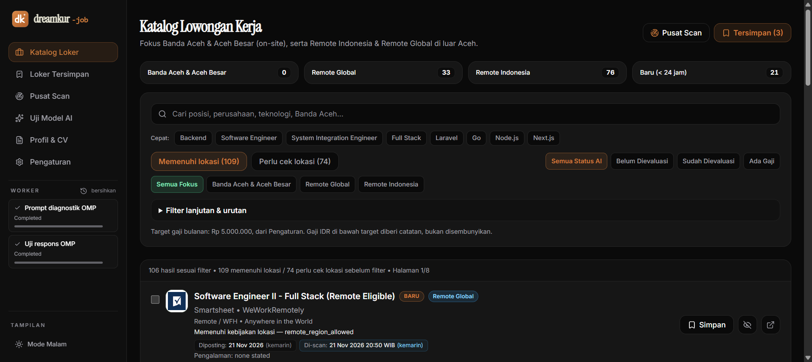
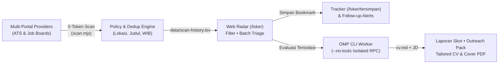

<div align="center">

# `career -job`

**Local-First Job Radar, Multi-Portal ATS Scanner & AI Career Assistant**

*Zero-Token Discovery • Guarded Local AI Evaluation • Dark-Mode Command Center*

[](https://nodejs.org/)
[](web/)
[](#arsitektur-ai--keamanan-omp)
[](#kontrak-privasi--keamanan-data)
[](LICENSE)

[Fitur Utama](#-fitur-utama) • [Arsitektur](#-arsitektur-sistem) • [Mulai Cepat](#-panduan-cepat-quick-start) • [Keamanan & Privasi](#-kontrak-privasi--keamanan-data) • [Pengujian](#-pengujian--validasi)

</div>

---

## Pratinjau Antarmuka (Mode Malam)

<p align="center">
  
</p>

> Antarmuka `/loker` menampilkan ringkasan fokus geografi secara real-time, filter cepat tech stack, badge `BARU` (`< 24 jam`), serta chip waktu **`Diposting:`** dan **`Di-scan:`** berbasis hari kalender WIB (`kemarin`, `hari ini`, `X hari lalu`).

---

## Mengapa `career -job`?

Sebagian besar *job tracker* menuntut Anda menyalin lowongan secara manual, mengirim CV ke cloud pihak ketiga, atau membakar kuota AI hanya untuk membaca halaman lowongan.

**`career -job`** memisahkan pekerjaan menjadi tiga lapisan disiplin:

1. **Zero-Token Discovery (`scan.mjs`)** — Pemindaian puluhan ATS & portal kerja berjalan murni melalui parser HTTP/HTML deterministik di mesin Anda. Tidak memakai 1 token LLM pun untuk mengumpulkan, memfilter lokasi, atau mendeteksi duplikasi.
2. **Isolated Local AI Intelligence (`omp`)** — Evaluasi kecocokan CV, ekstraksi PDF/TeX, dan penyusunan draf lamaran hanya aktif saat Anda memintanya, dijalankan dalam sesi `omp` terisolasi tanpa tool tulis sembarangan (`--no-tools --no-extensions --no-skills`).
3. **Human-in-the-Loop Action** — Tidak ada pengiriman lamaran otomatis di belakang layar. Semua status lamaran sinkron melalui sumber kebenaran Markdown/JSON lokal (`data/`), sementara keputusan kirim Email, WhatsApp, atau LinkedIn DM selalu berada di tangan Anda.

---

## Strategi & Fokus Pencarian

Kebijakan geografi aktif di [`portals.yml`](portals.yml) (mengacu ke template [`templates/portals.example.yml`](templates/portals.example.yml)) dibagi secara ketat ke dalam dua jalur:

| Jalur | Wilayah Target | Kebijakan |
|---|---|---|
| **Prioritas On-Site / Hybrid** | **Banda Aceh** & **Aceh Besar** | Diterima untuk lowongan lokal di area Aceh |
| **Luar Aceh & Internasional** | **Remote Indonesia** & **Remote Global / Worldwide** | Wajib remote; lowongan on-site luar Aceh disaring otomatis |

---

## Arsitektur Sistem



---

## Fitur Utama

### Web Command Center ([`web/`](web/))
- **`/loker` — Katalog Lowongan Kerja**: Filter fokus lokasi (`Banda Aceh & Aceh Besar`, `Remote Indonesia`, `Remote Global`), chip stack cepat (`Laravel`, `Go`, `Node.js`, `Next.js`, dll.), filter status AI, pengurutan gaji & terbaru, serta multi-select untuk simpan/analisis batch.
- **`/loker/[id]` — Detail Lowongan, Evaluasi AI & Outreach Pack**: Analisis kecocokan berbasis `cv.md`, catatan pribadi & draf surat lamaran persisten (`data/saved-jobs.json`), template **Outreach Pack** siap salin (**Email**, **WhatsApp**, **LinkedIn DM**), generator **Cover Letter PDF** & **CV Tailored PDF**, serta peringatan tenggat (`Menutup segera`).
- **`/loker/tersimpan` — Pelacak Pipeline & Tindak Lanjut**: Manajemen status lamaran lewat jalur tunggal `set-status.mjs`, penghitungan metrik pipeline, dan pengingat otomatis `Perlu follow-up` untuk lamaran `Applied` yang melewati ambang hari WIB.
- **`/scanner` & `/portals` — Mesin Scan & Manajemen Sumber**: Jalankan `scan.mjs` langsung dari browser dengan log streaming real-time, aktif/nonaktifkan portal atau tambah perusahaan baru langsung ke `portals.yml`, cek kesehatan board, dan integrasi jadwal harian Windows (`scripts/register-scan-task.ps1`).
- **`/ai-tester`, `/cv`, & `/config` — Diagnostik Model, Profil & Template**: Uji respons model aktif `omp`, editor live `cv.md` dengan konversi PDF/TeX/Markdown, editor `config/profile.yml`, dan galeri template HTML/LaTeX.

---

## Arsitektur AI & Keamanan OMP

- **Pemindaian portal (`scan.mjs`)**: 100% deterministik (0 token LLM). Pilihan model AI **tidak memengaruhi** jumlah maupun akurasi hasil scan lowongan.
- **Evaluasi & penulisan (`/api/run`, `/ai-tester`, impor CV)**: Memanggil `omp` CLI lokal dalam mode teks-murni terisolasi (`--no-tools --no-extensions --no-skills --no-rules`) dengan konfigurasi `modelRoles` (`default` / `smol` / `slow`) yang sudah aktif pada OMP Anda.

---

## Panduan Cepat (Quick Start)

### Prasyarat
- **Node.js** `^22.13.0 || >=23.4.0` (dibutuhkan untuk `node:sqlite` dan `node --test` glob).
- **OMP CLI (`omp`)** terpasang & terautentikasi bila menjalankan evaluasi AI / konversi CV.
- **Playwright Chromium** untuk render PDF CV/surat lamaran dan browser test suite.

### 1. Instalasi Dependensi

```bash
# 1. Clone repositori
git clone https://github.com/SyukurGit/career_job.git
cd career_job

# 2. Instal dependensi root
npm install

# 3. Instal dependensi antarmuka web
cd web
npm install
```

### 2. Siapkan Berkas Lokal Anda (Gitignored)

Berkas data pribadi sengaja tidak pernah diikutsertakan di repositori ini. Siapkan dari template yang tersedia:

```bash
# Profil kandidat
cp config/profile.example.yml config/profile.yml

# Daftar portal & kebijakan wilayah
cp templates/portals.example.yml portals.yml

# (Opsional) Environment variables lokal
cp .env.example .env
```

Kemudian isi `cv.md` di root repositori (atau impor langsung lewat halaman `/cv` di browser).

### 3. Jalankan Aplikasi Web

```bash
cd web
npm run build
npm run start -- -p 3000
```

Atau jalankan dari root:

```bash
npm run ui
```

Buka **`http://127.0.0.1:3000`** di browser Anda.

<details>
<summary><strong>4. Perintah Scan CLI & Jadwal Otomatis Windows</strong></summary>

```bash
# Validasi struktur dan kebijakan portals.yml
node validate-portals.mjs

# Jalankan pemindaian portal tanpa token AI
node scan.mjs

# Daftarkan scan harian otomatis pukul 08:00 WIB (Windows Task Scheduler)
pwsh -NoProfile -ExecutionPolicy Bypass -File scripts/register-scan-task.ps1 -Action Register -Time 08:00
```

</details>

---

## Struktur Repositori

```text
.
├── config/            # Contoh konfigurasi (*.example.*) & profile.yml lokal
├── data/              # Tracker lamaran, saved-jobs.json, riwayat scan (lokal)
├── docs/assets/       # Aset dokumentasi visual README
├── fonts/             # Font lokal (DM Sans, Space Grotesk) untuk render PDF offline
├── lib/               # Modul inti bersama (lock, parser tanggal WIB, YAML, privacy guard)
├── modes/             # Prompt instruksi AI per mode analisis
├── output/            # Hasil generate PDF CV & surat lamaran (lokal)
├── providers/         # Adapter parser ATS & job board
├── reports/           # Laporan evaluasi lowongan Markdown (lokal)
├── scripts/           # Helper CLI, launcher UI, pengecek sintaks, Task Scheduler
├── templates/         # Template CV HTML/LaTeX, surat lamaran, schema status
├── utils/             # Utilitas bantu CLI
├── web/               # Aplikasi Next.js Web UI (src/ & tests/)
├── scan.mjs           # Mesin pemindaian multi-portal utama (zero-token)
├── generate-pdf.mjs   # Generator CV PDF berbasis Playwright
└── generate-cover-letter.mjs
```

---

## Kontrak Privasi & Keamanan Data

Seluruh aturan keamanan didokumentasikan di [`DATA_CONTRACT.md`](DATA_CONTRACT.md) dan ditegakkan oleh [`.gitignore`](.gitignore):

- **Zero Credential & PII Exposure**: `.env`, `cv.md`, `/*.pdf`, `config/profile.yml`, `portals.yml`, `data/*`, `reports/*`, `output/*`, `jds/*`, `documents/*`, `interview-prep/*`, `.career-ops-web/`, `.career-ops-locks/`, serta file cadangan `*.bak*` diblokir permanen dari Git.
- **Loopback Isolation**: Server Web UI secara bawaan hanya bind ke `127.0.0.1` dengan validasi origin/host ketat pada `web/src/lib/origin-guard.mjs`.
- **Anti Prompt Injection Guard**: Deskripsi lowongan dari portal eksternal diperlakukan ketat sebagai data mentah, bukan instruksi agent.

---

## Pengujian & Validasi

Dari direktori **root**:

```bash
npm run lint                # Syntax check semua berkas .mjs aktif
node validate-portals.mjs   # Validasi skema & kebijakan portals.yml
```

Dari direktori **`web/`**:

```bash
npm run typecheck           # Pemeriksaan tipe TypeScript (tsc --noEmit)
npm run test:quick          # Uji cepat 9 suite inti (~1–2 detik)
npm test                    # Seluruh unit test (node --test)
npm run build               # Production build Next.js
npm run test:browser        # End-to-end Playwright browser suites
```

---

## Lisensi & Atribusi

Dirilis di bawah lisensi [MIT License](LICENSE). Dikembangkan dan dikustomisasi lebih lanjut dari fondasi proyek open-source `career-ops`.
